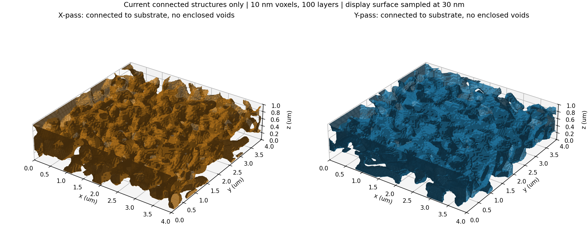
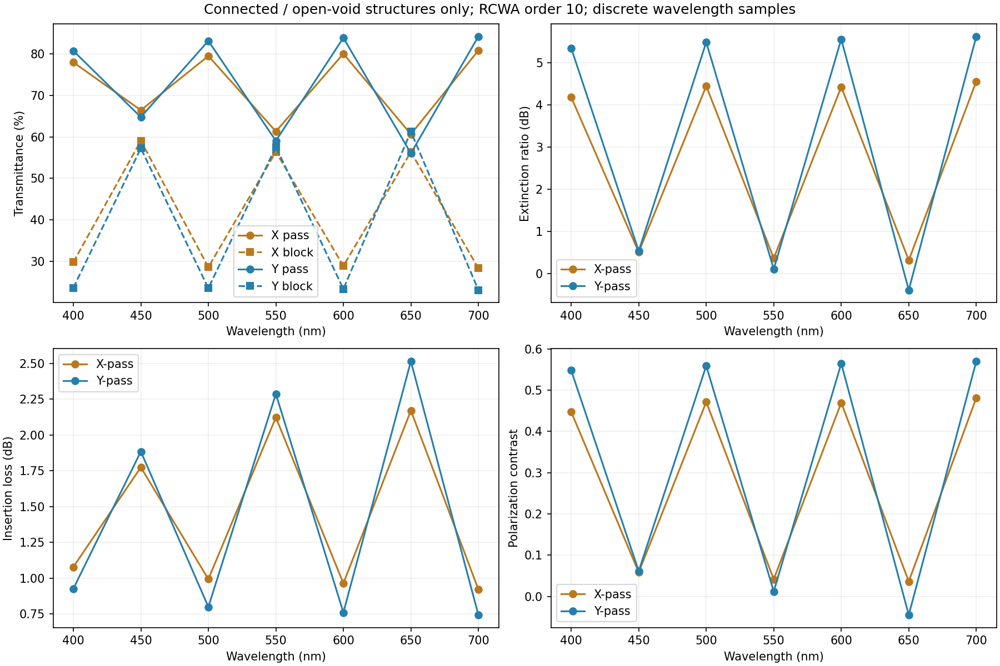
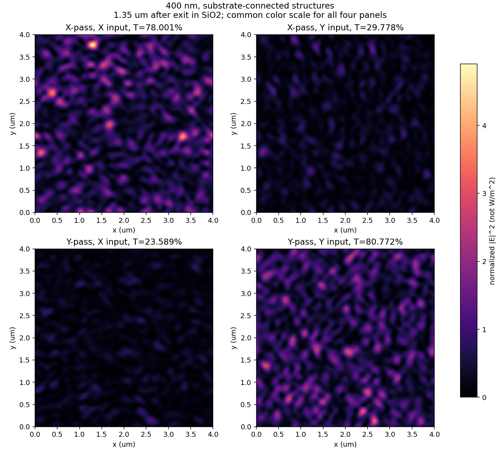
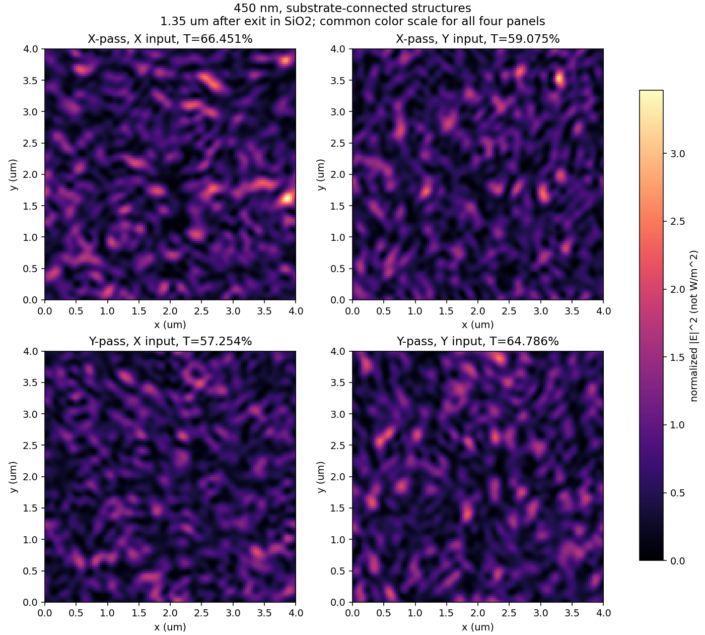
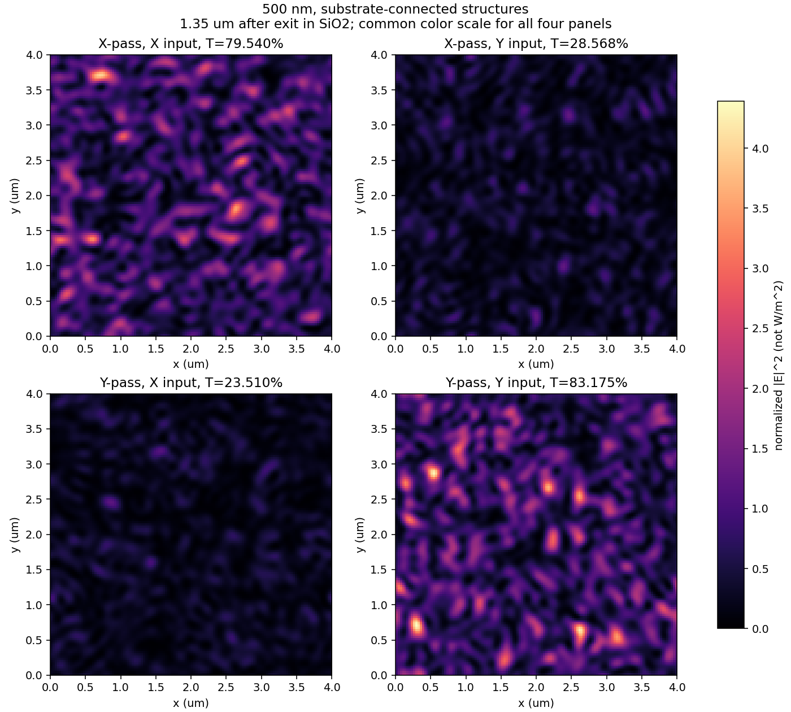
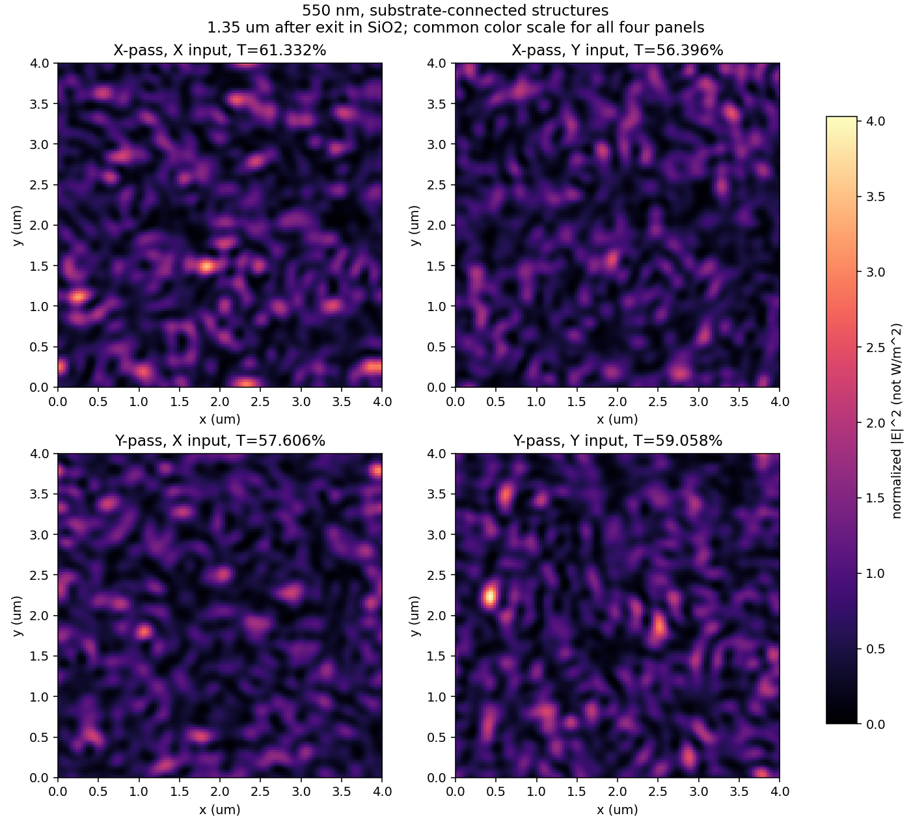
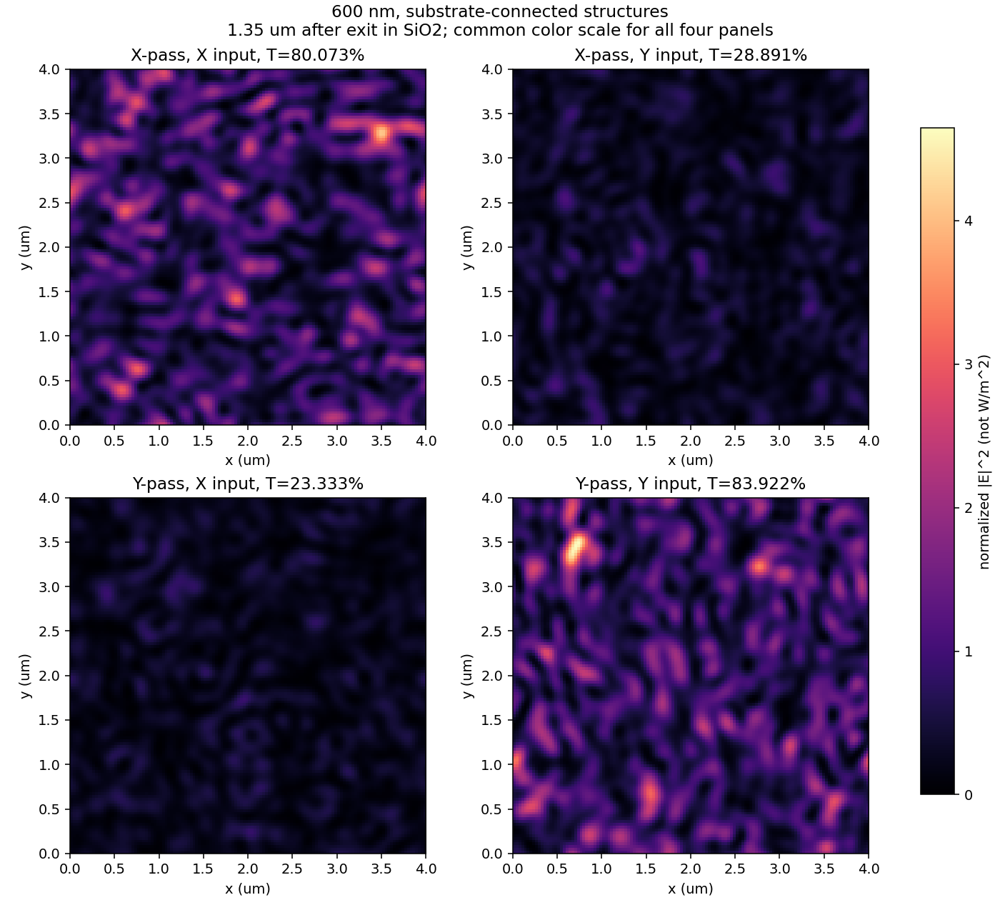
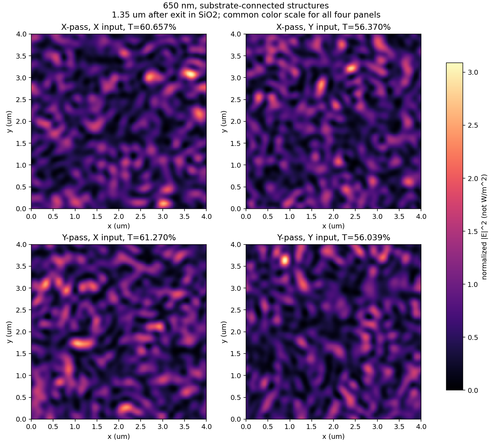
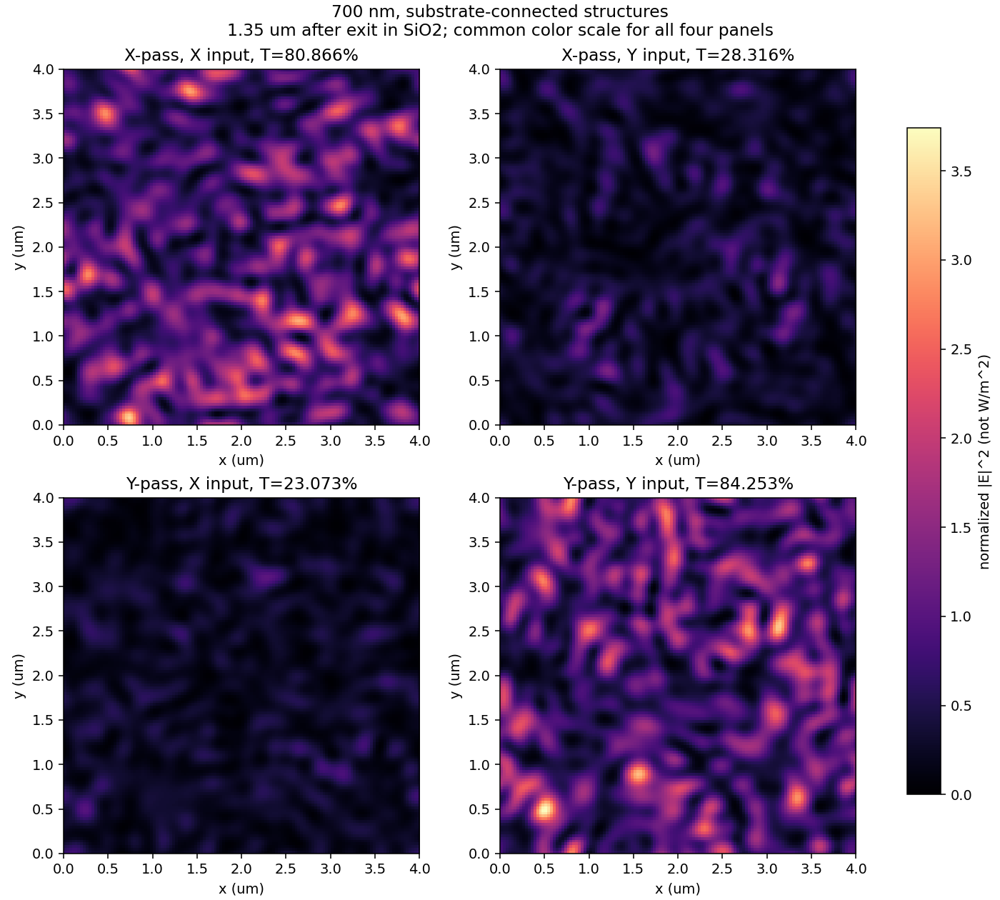

# 기판 연결 X-pass / Y-pass 최신 구조와 광학 결과

> 대상은 연결성·열린 공극 처리를 완료한 두 구조뿐입니다. 이전 원본과 100 nm 공정 변환 후보의 성능·필드는 포함하지 않습니다.

평가 완료: **14/14개 구조·파장 조합**, 각 조합마다 X·Y 선형 편광을 독립 입사시켰습니다.

## 구조와 계산 조건

- 구조: 4 × 4 × 1 µm, 10 nm 정육면체 voxel, 100층, TiO₂/공기 및 SiO₂ 기판.
- X 구조는 원본 best step 222, Y 구조는 step 274에서 연결성 조건을 적용한 고정 스냅샷입니다.
- 두 구조 모두 고체 연결 성분 1개, 기판 연결, 밀폐 공극 0개입니다. 면 접촉(6-neighbor) 기준이며, 모든 공극은 윗면으로 연결됩니다.
- 400, 450, 500, 550, 600, 650, 700 nm의 **이산 파장**을 계산했습니다. 연속 스펙트럼 검증은 아닙니다.
- 실제 계산 입력: 수직 입사 단색 평면파, 입사 전기장 진폭 1, X 또는 Y 선형 편광. 두 편광은 동시 입사가 아닌 독립 계산입니다.
- GPU RCWA order 10, complex128입니다. FDTD 시간영역 계산이나 실험 측정이 아닙니다.
- 모니터: 필터 출구 이후 **SiO₂ 안으로 1.35 µm**, 4 × 4 µm 면의 128 × 128점.
- `detector_gap_um=0.35`가 코드에서 총 높이 1 µm와 합쳐져 전파 거리 1.35 µm로 사용됩니다. 350 nm 관측면으로 해석하면 안 됩니다.
- 형상 연결성은 검증했으나 최소 배출 통로 폭, 실제 현상 속도, 수축·기계 안정성과 차수 수렴은 미검증입니다.

## 구조 파일

| 필터 | 원본 배열 | 연결성 검사 |
|---|---|---|
| X-pass | [X_binary.npz](structures/X_binary.npz) | [X_topology.json](structures/X_topology.json) |
| Y-pass | [Y_binary.npz](structures/Y_binary.npz) | [Y_topology.json](structures/Y_topology.json) |

배열 순서는 `[상부→기판 z, x, y]`, 크기는 `(100,400,400)`입니다. 1은 TiO₂, 0은 공기입니다.

[X 원본 격자 단면](figures/X_sections.png) · [Y 원본 격자 단면](figures/Y_sections.png)

## 성능 지표

[전체 성능 CSV](metrics.csv) · [전체 성능 JSON](metrics.json) · [집계 JSON](summary.json) · [필드 통계 CSV](field_statistics.csv)

| 필터 | λ (nm) | TX (%) | TY (%) | 소광비 (dB) | 삽입손실 (dB) | 대비도 |
|---|---:|---:|---:|---:|---:|---:|
| X | 400 | 78.0012 | 29.7776 | 4.1821 | 1.0790 | 0.4474 |
| X | 450 | 66.4510 | 59.0753 | 0.5110 | 1.7750 | 0.0588 |
| X | 500 | 79.5404 | 28.5683 | 4.4470 | 0.9941 | 0.4715 |
| X | 550 | 61.3322 | 56.3964 | 0.3644 | 2.1231 | 0.0419 |
| X | 600 | 80.0731 | 28.8909 | 4.4272 | 0.9651 | 0.4697 |
| X | 650 | 60.6570 | 56.3697 | 0.3183 | 2.1712 | 0.0366 |
| X | 700 | 80.8660 | 28.3158 | 4.5574 | 0.9223 | 0.4813 |
| Y | 400 | 23.5895 | 80.7725 | 5.3455 | 0.9274 | 0.5479 |
| Y | 450 | 57.2539 | 64.7858 | 0.5367 | 1.8852 | 0.0617 |
| Y | 500 | 23.5098 | 83.1751 | 5.4874 | 0.8001 | 0.5593 |
| Y | 550 | 57.6059 | 59.0583 | 0.1081 | 2.2872 | 0.0124 |
| Y | 600 | 23.3333 | 83.9216 | 5.5590 | 0.7613 | 0.5649 |
| Y | 650 | 61.2705 | 56.0386 | -0.3876 | 2.5151 | -0.0446 |
| Y | 700 | 23.0725 | 84.2528 | 5.6249 | 0.7442 | 0.5700 |

### 전체 평가 파장 중 최악 조건

| 필터 | 최소 통과율 (%) | 최대 억제 편광 누설 (%) | 최소 소광비 (dB) |
|---|---:|---:|---:|
| X | 60.6570 | 59.0753 | 0.3183 |
| Y | 56.0386 | 61.2705 | -0.3876 |

**450/550/650 nm 중간 파장에서 선택성이 크게 약해질 수 있습니다. 400/500/600/700 nm만으로 대역 전체 성능을 판단하면 안 됩니다. 현재 두 필터 모두 전 평가 파장의 목표를 달성하지 못했습니다.**

정의: X-pass의 Tpass=TX, Tblock=TY이며 Y-pass는 반대입니다. 소광비=10log₁₀(Tpass/Tblock), 삽입손실=−10log₁₀(Tpass), 누설 억제량=−10log₁₀(Tblock), 대비도=(Tpass−Tblock)/(Tpass+Tblock). **TX/TY는 입사 편광별 전체 투과율**이며 출력 분석기를 통과한 특정 편광 성분의 파워가 아닙니다.

목표는 Tpass>80%, Tblock<10%입니다. 목표 충족 여부를 각 파장 JSON에 저장합니다. 평균값이 대역 전체의 성능을 보장하지 않습니다.

## 파장별 모니터 필드

|E|²는 정규화 전기장 세기이며 W/m² 또는 전력 투과율이 아닙니다. 각 파장의 네 패널은 같은 색상 범위를 사용하고, 다른 파장 사이에는 색상 최대값이 달라집니다. 위상 그림은 해당 복소 E의 진폭이 전체 최대의 0.1% 이하인 픽셀을 숨깁니다.

NPZ의 `E`는 complex128, 배열 `(Ex/Ey/Ez, x, y, 입사 X/Y)`입니다. 크기 `(3,128,128,2)`. `total_E2`, `transmission`, 좌표, 파장, 관측면과 구조 SHA256도 저장합니다. Re(E)는 phasor의 실수부이며 시간 애니메이션이 아닙니다.

### 400 nm

| 필터 | 복소 원본 데이터 | Re(E) | 성분별 진폭 | 성분별 위상 |
|---|---|---|---|---|
| X | [NPZ](fields/X_400nm.npz) / [지표](fields/X_400nm.json) | [Ex/Ey/Ez](figures/X_400nm_real.png) | [진폭](figures/X_400nm_amplitude.png) | [위상](figures/X_400nm_phase.png) |
| Y | [NPZ](fields/Y_400nm.npz) / [지표](fields/Y_400nm.json) | [Ex/Ey/Ez](figures/Y_400nm_real.png) | [진폭](figures/Y_400nm_amplitude.png) | [위상](figures/Y_400nm_phase.png) |

### 450 nm

| 필터 | 복소 원본 데이터 | Re(E) | 성분별 진폭 | 성분별 위상 |
|---|---|---|---|---|
| X | [NPZ](fields/X_450nm.npz) / [지표](fields/X_450nm.json) | [Ex/Ey/Ez](figures/X_450nm_real.png) | [진폭](figures/X_450nm_amplitude.png) | [위상](figures/X_450nm_phase.png) |
| Y | [NPZ](fields/Y_450nm.npz) / [지표](fields/Y_450nm.json) | [Ex/Ey/Ez](figures/Y_450nm_real.png) | [진폭](figures/Y_450nm_amplitude.png) | [위상](figures/Y_450nm_phase.png) |

### 500 nm

| 필터 | 복소 원본 데이터 | Re(E) | 성분별 진폭 | 성분별 위상 |
|---|---|---|---|---|
| X | [NPZ](fields/X_500nm.npz) / [지표](fields/X_500nm.json) | [Ex/Ey/Ez](figures/X_500nm_real.png) | [진폭](figures/X_500nm_amplitude.png) | [위상](figures/X_500nm_phase.png) |
| Y | [NPZ](fields/Y_500nm.npz) / [지표](fields/Y_500nm.json) | [Ex/Ey/Ez](figures/Y_500nm_real.png) | [진폭](figures/Y_500nm_amplitude.png) | [위상](figures/Y_500nm_phase.png) |

### 550 nm

| 필터 | 복소 원본 데이터 | Re(E) | 성분별 진폭 | 성분별 위상 |
|---|---|---|---|---|
| X | [NPZ](fields/X_550nm.npz) / [지표](fields/X_550nm.json) | [Ex/Ey/Ez](figures/X_550nm_real.png) | [진폭](figures/X_550nm_amplitude.png) | [위상](figures/X_550nm_phase.png) |
| Y | [NPZ](fields/Y_550nm.npz) / [지표](fields/Y_550nm.json) | [Ex/Ey/Ez](figures/Y_550nm_real.png) | [진폭](figures/Y_550nm_amplitude.png) | [위상](figures/Y_550nm_phase.png) |

### 600 nm

| 필터 | 복소 원본 데이터 | Re(E) | 성분별 진폭 | 성분별 위상 |
|---|---|---|---|---|
| X | [NPZ](fields/X_600nm.npz) / [지표](fields/X_600nm.json) | [Ex/Ey/Ez](figures/X_600nm_real.png) | [진폭](figures/X_600nm_amplitude.png) | [위상](figures/X_600nm_phase.png) |
| Y | [NPZ](fields/Y_600nm.npz) / [지표](fields/Y_600nm.json) | [Ex/Ey/Ez](figures/Y_600nm_real.png) | [진폭](figures/Y_600nm_amplitude.png) | [위상](figures/Y_600nm_phase.png) |

### 650 nm

| 필터 | 복소 원본 데이터 | Re(E) | 성분별 진폭 | 성분별 위상 |
|---|---|---|---|---|
| X | [NPZ](fields/X_650nm.npz) / [지표](fields/X_650nm.json) | [Ex/Ey/Ez](figures/X_650nm_real.png) | [진폭](figures/X_650nm_amplitude.png) | [위상](figures/X_650nm_phase.png) |
| Y | [NPZ](fields/Y_650nm.npz) / [지표](fields/Y_650nm.json) | [Ex/Ey/Ez](figures/Y_650nm_real.png) | [진폭](figures/Y_650nm_amplitude.png) | [위상](figures/Y_650nm_phase.png) |

### 700 nm

| 필터 | 복소 원본 데이터 | Re(E) | 성분별 진폭 | 성분별 위상 |
|---|---|---|---|---|
| X | [NPZ](fields/X_700nm.npz) / [지표](fields/X_700nm.json) | [Ex/Ey/Ez](figures/X_700nm_real.png) | [진폭](figures/X_700nm_amplitude.png) | [위상](figures/X_700nm_phase.png) |
| Y | [NPZ](fields/Y_700nm.npz) / [지표](fields/Y_700nm.json) | [Ex/Ey/Ez](figures/Y_700nm_real.png) | [진폭](figures/Y_700nm_amplitude.png) | [위상](figures/Y_700nm_phase.png) |

## 재현 및 파일 검증

1. 이 폴더를 내려받고 `index.html`을 브라우저로 열면 로컬에서 결과를 볼 수 있습니다. GitHub에서는 이 README의 그림과 표를 바로 볼 수 있습니다.
2. NumPy/SciPy가 있는 Python에서 `python scripts/verify.py`로 파일 해시, 배열과 연결성, 14개 계산 결과를 검사합니다.
3. GPU 재계산은 [REPRODUCE.md](REPRODUCE.md)를 따릅니다. 다른 사용자의 GPU 작업과 메모리를 먼저 확인하고 순차 실행하세요.
4. `python scripts/report.py`는 저장된 NPZ/JSON에서 그림과 이 보고서를 다시 만듭니다.

출처와 무결성: [계산 설정](config.json), [실행 환경](environment.json), [엔진 고정 버전](engine_sources.json), [파일 해시](manifest.json). 기존 연결 구조의 네 파장 평가와 재계산 투과율을 비교한 검증은 각 결과의 `reference_check`에 있습니다.

범위: 현재 구조에서 얻은 결과를 보존한 스냅샷입니다. 새로운 최적화 이력, 실제 제작 결과, 컬러 라우터 결합 결과 또는 LN 마이크로링 결과는 포함하지 않습니다.
