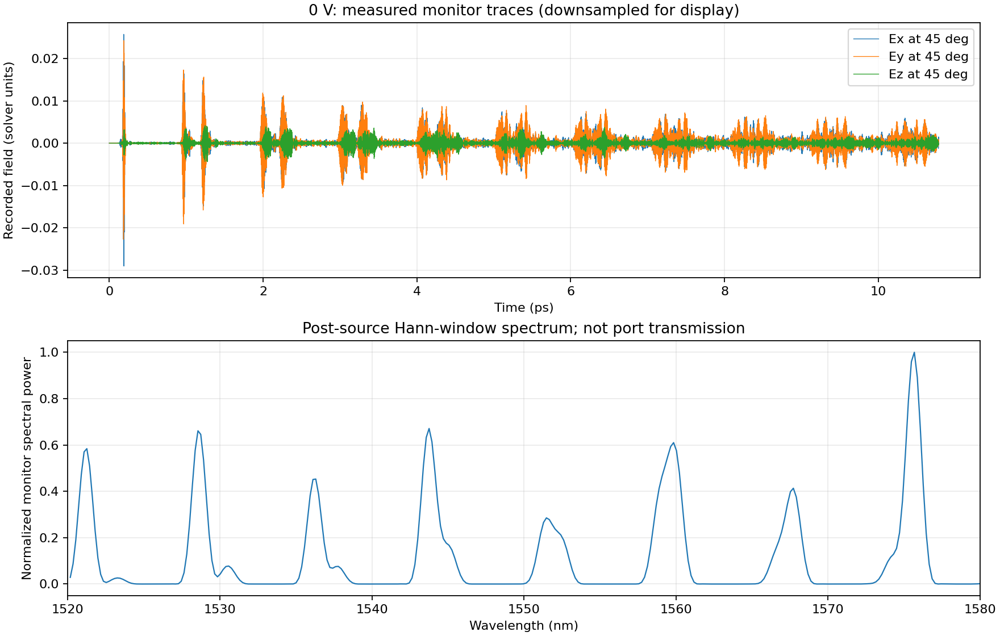
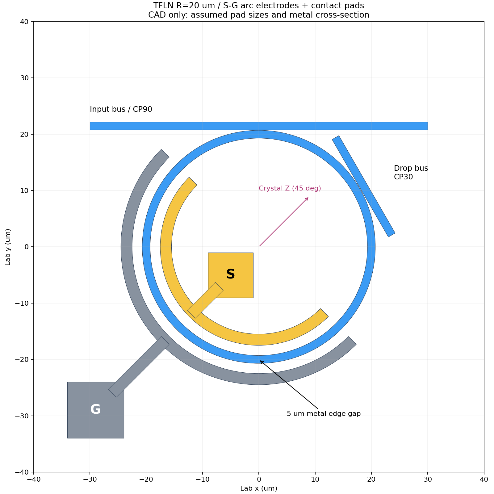

# TFLN 마이크로링: 결과 보기와 시뮬레이션 이어서 하기

**2026-10-12 공개 스냅샷.** TorchFDTD로 계산한 **반경 20 µm 단일 LN 링의 0 V 필드 기록**과, S–G 전극·패드를 포함한 **별도 CAD 시각화**입니다. 아래 그림은 저장된 실제 FDTD 필드에서 만들었습니다.

**아직 전압별 공진 이동(pm/V), TE₀ 모드 식별, 격자·시간 수렴, 최적화는 완료되지 않았습니다.** CAD의 패드를 연결해 얻은 전기장으로 계산한 결과도 아닙니다. 논문의 약 9.1 pm/V를 계산 결과로 사용하지 않았습니다.

## 1. 설치 없이 결과 보기



- [원본 필드 NPZ](results/baseline_0V/trace_000.npz): `signals`는 80,000 × 12 배열입니다.
- [실행 설정·격자·환경](results/baseline_0V/run.json), [광원·모니터·영역 JSON](results/baseline_0V/project.json)
- [이 연구만 다운로드 (ZIP)](https://github.com/Suhee-Shin/deep-learning-cr/raw/refs/heads/main/tfln-microring-handoff.zip): 압축을 풀면 코드·결과·CAD·실행 안내가 함께 들어 있습니다.

| 항목 | 실제 실행 조건 |
|---|---|
| LN | X-cut, 결정 Z축 lab 수평 대비 45° |
| 링 | 중심선 반경 20 µm, 폭 1.4 µm |
| 적층 | LN 600 nm, 식각 500 nm, 잔류 슬랩 100 nm, SiO₂ 2 µm, 상부 공기 |
| 격자 | 446 × 446 × 78, xy 100 nm / z 50 nm |
| 실행 | 0 V, 80,000 steps, 기록 길이 10.785216 ps |
| 하드웨어 | RTX 5880 Ada Generation 48 GB, Torch 2.6.0+cu118 |
| 완료 시각·시간 | 2026-10-09 23:58:35 KST, 18,294.810초 |

12개 열은 계산 좌표계의 0°, 45°, 90°, 180° 위치별 `Ex, Ey, Ez` 순서입니다. 계산 x축은 lab의 결정 Z축과 정렬되며, 전극 각도는 lab 기준입니다. 신호는 solver 필드 단위이고 아래 스펙트럼은 정규화한 모니터 파워입니다. **포트 투과율이 아닙니다.**

## 2. 전극·패드 구조 보기



[웹 UI용 CAD JSON](cad/lab_shshin_TFLN_R20_SG_pads_CAD.json)을 다운로드해 TorchFDTD의 **Open project (.json)**으로 불러온 뒤 3D 뷰를 선택합니다. [CAD 가정](cad/CAD_ASSUMPTIONS.json)도 함께 확인하세요.

- 노란색 S는 안쪽, 회색 G는 바깥쪽입니다. 반원 구간은 lab 135°–315°, 금속 가장자리 간격은 5 µm입니다.
- 전극 폭 2 µm / 두께 0.4 µm, S 패드 8×8 µm / G 패드 10×10 µm와 버스 폭 1.4 µm는 **탐색용 가정**입니다. 내부 S 패드는 배선이 링을 가로지르지 않는 시각화 배치이며, wire-bond 공정이 검증된 패드가 아닙니다.
- CAD에는 CP90/CP30 버스가 있지만 **위 실제 계산은 버스 없는 단독 링**입니다.
- CAD 금속은 색상 표시용 재료이며 실제 금속 광학 상수나 전압 경계조건이 없습니다. **이 CAD JSON의 Run 버튼으로 전압 변조 결과를 얻을 수 없습니다.**

## 3. 실행 환경 만들기

연구실 접속 권한 없이 자기 PC/GPU에서 실행할 수 있습니다. Python 3.12와 독립 환경을 권장합니다. 다음 명령은 저장소를 받은 뒤 `tfln-microring` 폴더에서 실행합니다.

```powershell
python -m venv .venv
.venv\Scripts\Activate.ps1
python -m pip install -e "./vendor/TorchFDTD[dev]"
python scripts/verify_handoff.py
python -m pytest vendor/TorchFDTD/tests -q
```

Linux/macOS에서는 활성화 명령을 `source .venv/bin/activate`로 바꿉니다. 실행 정책으로 PowerShell 활성화가 막히면 정책을 변경하지 말고 `.venv\Scripts\python.exe`로 각 명령의 `python`을 대체하세요.

GPU 실행에는 CUDA를 지원하는 PyTorch가 필요합니다. 아래 출력이 `True`인지 확인하고, 아니면 [PyTorch 공식 설치 안내](https://pytorch.org/get-started/locally/)에서 자기 드라이버에 맞는 빌드를 설치하세요. 기준 계산의 기록된 버전은 Torch 2.6.0+cu118이며 최신 환경에서 비트 단위 동일 결과를 보장하지 않습니다.

```powershell
python -c "import torch; print(torch.__version__); print(torch.cuda.is_available())"
```

자기 PC에서 CAD용 웹 UI를 열려면 다음을 실행하고 `http://127.0.0.1:8765`로 접속합니다. 기존 공용 서버를 재시작할 필요는 없습니다.

```powershell
python -m torchfdtd.cli serve --host 127.0.0.1 --port 8765
```

## 4. 계산 이어서 하기

모든 명령은 **`tfln-microring` 폴더** 기준입니다. 먼저 GPU 자원을 확인하고, 큰 작업은 한 번에 하나씩 실행합니다.

```powershell
nvidia-smi
python vendor/TorchFDTD/examples/linbo3_rib_voltage.py --plan --device cuda --steps 80000 --voltages 0 -1 1 -2 2 --out runs/planned_sweep
```

작은 CPU 기능 검증은 아래와 같습니다. 반경이 다르므로 실제 R=20 µm 결과와 혼동하지 마세요.

```powershell
python vendor/TorchFDTD/examples/linbo3_rib_voltage.py --device cpu --radius-um 1 --mesh-um .2 --mesh-z-um .1 --pml-cells 4 --steps 300 --voltages 0 --out runs/cpu_smoke
```

기준 0 V를 재현하려면:

```powershell
python vendor/TorchFDTD/examples/linbo3_rib_voltage.py --device cuda --steps 80000 --voltages 0 --out runs/baseline_0V
```

양·음 전압 비교를 시작하려면:

```powershell
python vendor/TorchFDTD/examples/linbo3_rib_voltage.py --device cuda --steps 80000 --voltages 0 -1 1 -2 2 --out runs/signed_voltage_sweep
```

각 전압은 순차 실행되고 완료된 시계열은 즉시 NPZ에 저장됩니다. **같은 명령과 같은 출력 폴더**로 다시 실행하면 일치하는 fingerprint의 완료된 전압은 건너뜁니다. 중단된 전압의 시간 step부터 복구하는 체크포인트 기능은 없습니다. 다른 설정이나 코드로 실행할 때는 새 출력 폴더를 사용하세요. 종료되지 않은 작업을 중복 실행하지 마세요.

공개 `results/baseline_0V`는 읽기용 원본입니다. 거기에 이어 쓰지 않습니다. 서로 다른 전압 목록은 fingerprint가 다르므로 위 전체 스윕 명령은 0 V도 새로 계산합니다. GPU 조건에 따라 오래 걸리며, 기록된 5시간은 기준 1회 실행 실측값이지 다른 장치의 시간 보장이 아닙니다.

## 5. 공진 후보 분석

먼저 전체 스펙트럼을 보고 고립된 피크를 고릅니다. 좁은 추적 창의 중심을 임의로 1550 nm에 고정하면 안 됩니다. 다음의 `TARGET_UM`을 직접 확인한 피크의 **µm 값**으로 바꾸세요.

```powershell
python vendor/TorchFDTD/examples/analyze_ln_ringdown.py runs/signed_voltage_sweep --target-um TARGET_UM --half-window-um .0005
```

출력은 `candidate_resonances.csv`, `candidate_analysis.json`입니다. 0 V 대비 이동(pm), 두 시간 창에서의 이동량 차이를 기록합니다. 짧은 기록과 분리된 복수 피크는 거부합니다. FFT 보간 간격은 물리적 분해능이 아니며, 후보가 나와도 TE₀ 확인·시간/격자 수렴 전에는 최종 감도로 보고하지 않습니다. 추적 창보다 이동이 크면 후보를 다시 확인해 창을 조정해야 합니다.

## 6. 남은 연구와 재현 범위

1. 실제 필드에서 같은 TE₀ 공진을 식별하고 양·음 S–G 전압의 이동을 비교합니다.
2. 80,000-step보다 긴 실행 및 미세 격자로 시간·공간 수렴을 검증합니다.
3. 현재 `E=V/d_eff`, `d_eff=2.5 µm`의 반원 방사 전기장 근사를 전극 정전계로 검증/교체합니다. 실제 간격 5 µm와 유효 거리 2.5 µm는 동일 개념이 아닙니다.
4. 금속 광학 손실, 모드 광원·버스 결합, 다중 링과 최적화를 추가합니다.

[탐색 후보 설정](config/research_sweep.json)은 실행된 결과가 아니라 연구 계획입니다. Bias/Control의 크기만으로 `+Bias+Control`을 단자 전압으로 확정하지 않습니다. 기본 부호는 `V_SG = V_signal - V_ground`입니다.

`project.json`은 영역·광원·모니터 기록입니다. 전체 이방성 재료는 실행 스크립트가 재구성하므로 **이 JSON만 CLI run에 넣는 것은 같은 계산이 아닙니다.** 또한 Python 작업은 웹 UI 세션과 자동 동기화되지 않으며 실시간 대시보드는 포함하지 않았습니다.

## 출처와 검증

- [TorchFDTD 원본](https://github.com/hyoseokp/TorchFDTD), 기준 커밋과 수정 범위: [PROVENANCE.json](PROVENANCE.json)
- 원본 코드 라이선스·고지: [MIT LICENSE](vendor/TorchFDTD/LICENSE), [THIRD_PARTY_NOTICES](vendor/TorchFDTD/THIRD_PARTY_NOTICES.txt)
- 참고 논문: [arXiv:2603.12934](https://arxiv.org/abs/2603.12934). 논문 PDF는 이 묶음에 재배포하지 않았습니다.
- 기준 계산의 소스 SHA-256과 이 묶음의 대응 소스가 일치함을 확인했습니다. 연결 키·접속 주소·로컬 사용자 경로는 포함하지 않았습니다.
- 데이터·소스 무결성 확인: `python scripts/verify_handoff.py`. 테스트 통과는 코드 검증이며 소자 감도 정확도의 증거가 아닙니다.
